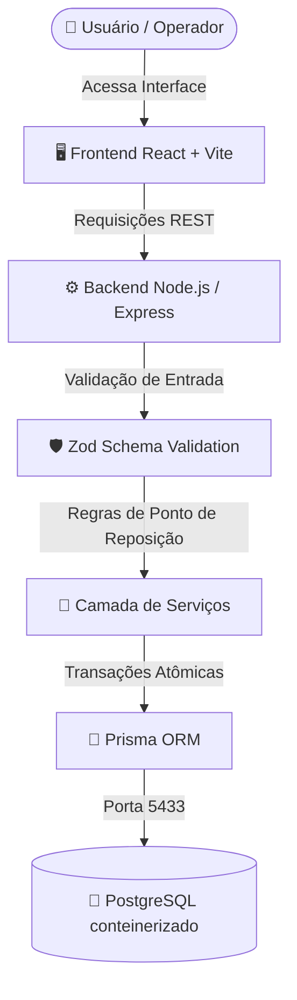
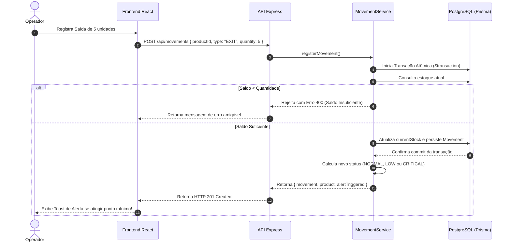

<div align="center">

# 🚀 Stockly

### Projeto desenvolvido para a matéria **BOOTCAMP III**


</div>

---

## 📑 Sumário

- [👥 Membros do Grupo](#-membros-do-grupo)
- [📌 Visão Geral do Projeto](#-visão-geral-do-projeto)
- [🛠️ Tecnologias Utilizadas](#️-tecnologias-utilizadas)
- [⚙️ Guia de Instalação e Execução](#️-guia-de-instalação-e-execução)
- [🧱 Registro de Decisões Arquiteturais (ADRs)](#-registro-de-decisões-arquiteturais-adrs)

---

## 👥 Membros do Grupo

| 👤 Nome | 🎓 RA |
|---|---|
| Erick Guilherme Mesquita Diniz | 22305289 |
| Cauã Leite Sousa Paniagua | 22405235 |
| Matheus Shiokawa Silva | 22305323 |
| Marlon Giovanni Coelho Paganotto | 22301592 |
| Mateus Cavalcante Rodrigues | 22303356 |
| Francisco Matheus Pinheiro de Brito da Silva | 22303388 |

---

## 📌 Visão Geral do Projeto

> Sistema de controle de estoque com ponto de reposição para pequeno varejo.

- **Problema resolvido:** Donos de pequenos comércios (mercadinhos, padarias, lojas de bairro) geralmente só percebem que um produto acabou quando o cliente já pediu por ele, perdendo a venda. O controle de estoque, quando existe, costuma ser manual (caderno/planilha), sem alerta antecipado de reposição.
- **Solução proposta:** Sistema de gestão de estoque que registra entradas/saídas de produtos, calcula o nível atual e dispara alertas quando o estoque atinge um ponto mínimo de reposição definido para cada item.
- **Público-alvo:** Pequenos comerciantes e varejistas que hoje controlam estoque de forma manual ou não estruturada.
- **Principais funcionalidades:**
  - [x] Cadastro de produtos com ponto de reposição e SKU único
  - [x] Registro atômico de movimentações de estoque (entradas e saídas)
  - [x] Disparo automático de alertas quando o estoque atinge o nível mínimo (`CRITICAL` e `LOW`)
  - [x] Histórico de movimentações por produto
  - [x] Painel de visão geral do estoque (KPIs e resumo analítico)
  - [x] Test harness automatizado com 100% de aprovação (Jest + Supertest)

---

## 🏛️ Arquitetura e Fluxo da Aplicação



### Fluxo de Registro de Movimentação e Alerta de Reposição


---

## 🛠️ Tecnologias Utilizadas

<div align="center">


</div>

- **Frontend:** React (Vite + TypeScript)
- **Backend:** Node.js (Express)
- **ORM:** Prisma 6.4.1
- **Banco de dados:** PostgreSQL 16
- **Testes Automatizados:** Jest + Supertest (13 testes, 100% de aprovação)
- **Infraestrutura:** Docker & Docker Compose

---

## ⚙️ Guia de Instalação e Execução

### ✅ Pré-requisitos

- Node.js (v18+)
- Docker e Docker Compose instalados e em execução

### 📥 1. Clonar o repositório

```bash
git clone https://github.com/francisco-mpinheiro/projeto-bootcamp-III.git
cd projeto-bootcamp-III
```

### 🐳 2. Subir o Banco de Dados PostgreSQL no Docker

O arquivo `docker-compose.yml` mapeia o banco na porta **5433** (para não conflitar com portas locais padrão):

```bash
docker compose up -d
```

### 📦 3. Configurar e Inicializar o Backend

```bash
cd backend
npm install

# Copiar variáveis de ambiente
cp .env.example .env

# Sincronizar schema com o banco de dados
npx prisma db push

# Popular com dados de teste (opcional)
npm run seed

# Executar os testes automatizados (deve reportar 100% de aprovação)
npm test

# Iniciar o servidor em modo de desenvolvimento
npm run dev
```
> O backend estará disponível em: `http://localhost:3001` (Health check: `http://localhost:3001/api/health`)

### 💻 4. Configurar e Inicializar o Frontend

```bash
cd ../frontend
npm install
npm run dev
```

---

## 🧱 Registro de Decisões Arquiteturais (ADRs)

> Registro formal das decisões técnicas, justificativas e trade-offs assumidos.

### ADR 001 — Escolha da Stack Tecnológica
- **Contexto:** Necessidade de criar uma aplicação fullstack moderna, de fácil manutenção e suporte a dados relacionais para controle estrito de estoque.
- **Decisão:** Adoção de React (frontend), Node.js com Express (backend), Prisma ORM, PostgreSQL e Docker Compose.
- **Status:** ✅ Aceita
- **Consequências:** O uso do Prisma simplifica a modelagem relacional e tipagem segura, enquanto o PostgreSQL no Docker garante que todos os membros do grupo e avaliadores executem exatamente a mesma versão do banco sem instalações manuais complexas.

### ADR 002 — Transações Atômicas para Movimentações de Estoque
- **Contexto:** Registrar uma movimentação exige duas escritas: criar o registro histórico na tabela `movements` e recalcular o campo `currentStock` na tabela `products`. Falhas no meio do processo gerariam inconsistência e estoque "fantasma" ou negativo.
- **Decisão:** Todo o processamento de movimentação no `movementService` ocorre dentro de uma transação serializada com `prisma.$transaction`.
- **Status:** ✅ Aceita
- **Consequências:** Garante consistência ACID. Caso o saldo seja insuficiente para uma saída ou ocorra erro em qualquer etapa, a transação sofre rollback automático e nenhum registro órfão é gravado.

### ADR 003 — Isolamento de Portas e Sanitização com Zod
- **Contexto:** Desenvolvedores frequentemente possuem serviços locais prévios rodando na porta padrão `5432` do PostgreSQL. Além disso, requisições malformadas poderiam quebrar regras de negócio de estoque.
- **Decisão:** Mapear o container PostgreSQL para a porta `5433:5432` no host e utilizar o `Zod` na camada de controladores para sanitização rígida de tipos e valores numéricos antes da camada de persistência.
- **Status:** ✅ Aceita
- **Consequências:** Elimina conflitos de rede no ambiente de desenvolvimento da equipe e blinda a API contra payloads maliciosos, números negativos inválidos e tipos inconsistentes.

---

<div align="center">
  Feito para a disciplina BOOTCAMP III
</div>
