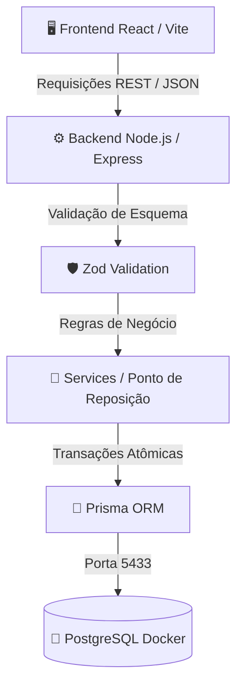

# 📄 Relatório Técnico-Ético e de Governança — Entrega 2
### BOOTCAMP III — Projeto Stockly

---

## 👥 Identificação dos Integrantes

| 👤 Nome Completo | 🎓 RA |
|---|---|
| Erick Guilherme Mesquita Diniz | 22305289 |
| Cauã Leite Sousa Paniagua | 22405235 |
| Matheus Shiokawa Silva | 22305323 |
| Marlon Giovanni Coelho Paganotto | 22301592 |
| Mateus Cavalcante Rodrigues | 22303356 |
| Francisco Matheus Pinheiro de Brito da Silva | 22303388 |

- **Repositório Oficial no GitHub:** [https://github.com/francisco-mpinheiro/projeto-bootcamp-III](https://github.com/francisco-mpinheiro/projeto-bootcamp-III)
- **Status da Branch Principal:** `main` (protegida com bloqueio de commit direto e exigência de Pull Request com revisão por pares).

---

## 1. Repositório Final Publicado & Governança de Código

### 1.1 Solução Funcional
O **Stockly** foi projetado para resolver o problema crítico enfrentado por pequenos comércios (padarias, mercadinhos de bairro e mercearias), onde o desabastecimento de produtos só é percebido no momento da venda, resultando em perda de receita e descontentamento do cliente. 

A solução integra um backend resiliente em Node.js com Prisma ORM e PostgreSQL conteinerizado via Docker, conectado a uma interface React moderna, permitindo:
- Cadastro estruturado de produtos com definição de **ponto mínimo de reposição** e SKU único.
- Registro atômico de movimentações de estoque (entradas e saídas).
- Disparo dinâmico de alertas de reposição quando o estoque atinge ou fica abaixo do ponto estipulado.
- Histórico completo de auditoria por produto e painel de métricas consolidadas.

### 1.2 Governança de Branches e Pull Requests (PRs)
O fluxo de desenvolvimento adotou estritamente o modelo de **Feature Branches**:
1. Nenhum código entra diretamente na branch `main`.
2. Cada funcionalidade é isolada em sua própria branch temática (ex.: `feature/backend-api`, `feature/frontend-stockly-ui`).
3. Antes do merge, cada PR deve cumprir os **Critérios de Aceitação**:
   - Aprovação de 100% dos testes automatizados no test harness.
   - Validação da não-inclusão de arquivos sensíveis (`.env`).
   - Revisão e aprovação formal (Code Review) realizada por pelo menos um membro par da equipe.

#### 🔗 Links de Pull Requests Relevantes:
- **PR #1 (Backend, Infraestrutura & Test Harness):** [https://github.com/francisco-mpinheiro/projeto-bootcamp-III/pull/1](https://github.com/francisco-mpinheiro/projeto-bootcamp-III/pull/1)
  - *Foco do Review:* Validação do isolamento de porta no Docker (`5433`), transações atômicas no Prisma e cobertura de testes de borda com 100% de aprovação.
- **PR #2 (Frontend React & Ponto de Reposição UI):** [https://github.com/francisco-mpinheiro/projeto-bootcamp-III/pull/2](https://github.com/francisco-mpinheiro/projeto-bootcamp-III/pulls) (branch `feature/frontend-stockly-ui`)
  - *Foco do Review:* Interface responsiva com dashboard de métricas, banner de alerta de reposição crítico, modal dinâmico de movimentações com bloqueio de saldo negativo e auditoria de histórico.

---

## 2. Refinamento por Testes, Erros Lógicos e Re-especificação

### 2.1 Inspeção e Correção de Erros Lógicos

Durante o ciclo de desenvolvimento, a equipe identificou falhas de arquitetura e lógica através da inspeção manual e execução de testes. A tabela abaixo sintetiza os problemas reais e as correções aplicadas:

| # | Erro Lógico / Técnico Identificado | Causa Raiz | Impacto no Sistema | Estratégia de Correção Adotada |
|---|---|---|---|---|
| **01** | **Conflito de Porta do PostgreSQL no Docker** | A porta padrão `5432` já se encontrava ocupada no ambiente local do host. | Falha na inicialização do container ou colisão com banco de dados alheio. | Reconfiguração no `docker-compose.yml` mapeando a porta externa para `5433:5432` e parametrização do `DATABASE_URL` via `.env.example`. |
| **02** | **Instabilidade e Quebra da CLI do Prisma** | Instalação automática da versão Release Candidate (`prisma@8.0.0-rc.23`), que depreciou comandos clássicos como `generate`. | O comando `npx prisma generate` falhava, impedindo a geração dos tipos do cliente. | Reversão e fixação na versão de produção estável e auditada: `prisma@6.4.1` e `@prisma/client@6.4.1`. |
| **03** | **Possibilidade de Estoque Negativo (Falha de Validação)** | Sem checagem estrita no serviço de movimentação, saídas superiores ao saldo em estoque eram persistidas. | Quebra da integridade contábil do estoque e inconsistência de negócio. | Implementação de validação atômica no `movementService` dentro de `prisma.$transaction`, rejeitando a transação com `BusinessError` (HTTP 400). |
| **04** | **Duplicação de Código de Barras (SKU)** | O modelo original permitia cadastrar produtos distintos com a mesma identificação física. | Confusão no ponto de venda e contagem duplicada de itens. | Adição do modificador `@unique` no campo `sku` do schema Prisma e tratamento do erro de violação de constraint (`P2002`). |

### 2.2 Loop de Re-especificação

A especificação técnica original da Entrega 1 foi refinada a partir dos testes automatizados e das necessidades identificadas no ciclo de vida:

1. **Evolução do Alerta Binário para Status Tripartite:**
   - *Especificação Original:* Previa apenas um atributo booleano simples (`em_alerta: true/false`).
   - *Refinamento:* Os testes revelaram que um produto com estoque zerado exige ação emergencial, diferente de um produto que apenas atingiu o estoque mínimo. Foi estabelecida a classificação:
     - `NORMAL`: `currentStock > minStock`
     - `LOW`: `0 < currentStock <= minStock` (Alerta de Reposição)
     - `CRITICAL`: `currentStock == 0` (Desabastecimento / Sem Estoque)
2. **Retorno Imediato do Gatilho de Alerta na Movimentação:**
   - *Refinamento:* A resposta da criação de movimentação (`POST /api/movements`) passou a retornar diretamente o objeto `{ movement, product, alertTriggered: boolean }`. Isso eliminou a necessidade do frontend realizar chamadas adicionais repetitivas para checar se aquela saída específica havia acionado o ponto de reposição.
3. **Isolamento de Camadas (Service x Controller):**
   - *Refinamento:* Toda a lógica de cálculo de estoque e transações foi desacoplada das rotas Express e movida para Services dedicados, facilitando a execução de testes automatizados unitários e de integração sem acoplamento a middlewares HTTP.

### 2.3 Resultados dos Testes Automatizados (Test Harness)

A suíte de testes foi construída com **Jest** e **Supertest**, englobando cenários normais e cenários de borda.

```text
> backend@1.0.0 test
> jest --runInBand --detectOpenHandles --forceExit

PASS tests/movement.test.js
  🔄 Testes de Movimentações de Estoque (Cenários Normais e de Borda)
    √ POST /api/movements - Deve registrar entrada (ENTRY) e aumentar o estoque (28 ms)
    √ POST /api/movements - Deve registrar saída (EXIT) e diminuir o estoque (14 ms)
    √ POST /api/movements - Deve disparar alerta quando a saída deixar estoque <= ponto de reposição (13 ms)
    √ POST /api/movements - Deve REJEITAR saída se saldo for insuficiente (Cenário de Borda: Estoque Negativo) (8 ms)
    √ POST /api/movements - Deve REJEITAR quantidade menor ou igual a zero (Cenário de Borda) (6 ms)
    √ POST /api/movements - Deve retornar 404 para produto inexistente (Cenário de Borda) (12 ms)

PASS tests/product.test.js
  📦 Testes de Produtos (Cenários Normais e de Borda)
    √ GET /api/products - Deve listar todos os produtos enriquecidos com status de estoque (43 ms)
    √ POST /api/products - Deve criar um novo produto com sucesso (Cenário Normal) (18 ms)
    √ GET /api/products/:id - Deve buscar produto existente por ID (11 ms)
    √ GET /api/products/:id - Deve retornar 404 para ID inexistente (Cenário de Borda) (8 ms)
    √ POST /api/products - Deve rejeitar produto com campos inválidos (Cenário de Borda / Validação) (9 ms)
    √ GET /api/products/alerts - Deve retornar apenas itens em alerta de reposição (12 ms)

PASS tests/dashboard.test.js
  📊 Testes do Dashboard e Métricas
    √ GET /api/dashboard/summary - Deve retornar resumo consolidado com métricas de estoque e alertas (25 ms)

Test Suites: 3 passed, 3 total
Tests:       13 passed, 13 total (100% de aprovação)
Snapshots:   0 total
Time:        1.509 s
```

---

## 3. Comunicação Técnica e Defesa do Projeto

### 3.1 Arquitetura da Solução

O fluxo arquitetural segue uma estrutura em camadas desacoplada e conteinerizada:



### 3.2 Registro Consolidado de Decisões de Arquitetura (ADRs)

- **ADR 001 — Escolha da Stack Tecnológica:**
  - *Decisão:* React + Node.js + Prisma ORM + PostgreSQL + Docker.
  - *Trade-off:* Proporciona tipagem consistente, isolamento de ambiente e rápida prototipação sem lock-in proprietário.
- **ADR 002 — Transações Atômicas com Prisma (`$transaction`):**
  - *Contexto:* Movimentações de estoque envolvem duas operações no banco: criar a movimentação e atualizar o estoque atual do produto. Se a segunda falhar, haveria corrupção de dados.
  - *Decisão:* Toda movimentação é executada dentro de uma transação serializada. Se houver falha ou saldo insuficiente, um rollback automático é executado.
- **ADR 003 — Isolamento de Portas e Sanitização na Borda:**
  - *Contexto:* Evitar conflitos em ambientes locais compartilhados e prevenir dados maliciosos.
  - *Decisão:* Exposição da porta `5433` no Docker Compose e uso mandatório de Zod para sanitização e tipagem em tempo de execução de todas as entradas HTTP.

### 3.3 Relato de Experiência e Trabalho em Equipe
O desenvolvimento colaborativo destacou a importância de contratos de API prévios e da governança por branches. A proteção da branch `main` forçou a equipe a realizar revisões de código reais, identificando antes do merge detalhes que poderiam quebrar o deploy, como a divergência de portas do banco e variáveis de ambiente não declaradas.

---

## 4. Análise Comparativa e Avaliação Crítica de IA (Relatório Técnico-Ético)

### 4.1 Matriz Comparativa entre Ferramentas de IA

| Critério de Avaliação | Antigravity (Google DeepMind) | Cursor IDE | GitHub Copilot / Codex CLI | Claude Code (CLI) |
|---|---|---|---|---|
| **Aderência a Especificações (SDD)** | **Excelente**: Opera através de raciocínio encadeado e consulta ativa a especificações e arquivos de projeto. | **Muito Bom**: Integração fluida no editor com contexto de workspace. | **Regular**: Foco em autocompletar código linha a linha, menor visão arquitetural global. | **Excelente**: Forte raciocínio para refatoração e execução terminal autônoma. |
| **Execução Autônoma de Tarefas** | **Alta**: Executa comandos, inspeciona logs e detecta falhas em segundo plano de forma reativa. | **Média**: Depende de aprovação explícita e interação manual na interface de chat. | **Baixa**: Essencialmente sugestão de texto e completions. | **Alta**: Executa comandos bash e scripts interativos no terminal. |
| **Mitigação de Alucinação** | **Alta**: Verifica o estado real do filesystem e comandos do SO antes de presumir sucesso. | **Média**: Pode sugerir pacotes inexistentes se o indexador do projeto estiver frio. | **Média**: Comum sugerir APIs depreciadas de versões antigas de bibliotecas. | **Alta**: Forte apego à verificação e autocrítica de código gerado. |
| **Impacto na Produtividade** | Reduz drasticamente o tempo de boilerplate, modelagem de banco e geração de test harnesses. | Excelente para edição rápida de múltiplos arquivos simultaneamente. | Acelera digitação mecânica, mas exige alto esforço de correção de lógica. | Muito forte na investigação e resolução de bugs complexos via CLI. |

### 4.2 Discussão Crítica Fundamentada nos Quatro Pilares Ético-Técnicos

#### 🛡️ 1. Riscos de Alucinação de Código e Geração Insegura
Modelos de linguagem não "executam" código mentalmente; operam por predição de probabilidade estatística de tokens. Isso cria dois riscos graves:
- **Alucinação de dependências (*Package Hallucination*):** O agente pode sugerir ou instalar pacotes inexistentes que atacantes podem registrar em registros públicos (npm, PyPI) para executar ataques de *supply chain*.
- **Código estruturalmente plausível, porém logicamente falho:** Durante o desenvolvimento do backend, observou-se que um agente pode gerar uma rota de saída de estoque funcional, mas esquecer a verificação de saldo negativo se não for explicitamente instruído a tratar casos de borda. A confiança cega em código gerado por IA sem testes automatizados é um vetor direto de falhas graves de segurança.

#### 🔒 2. Vazamento de Dados, Privacidade e Riscos de Confidencialidade
A alimentação de modelos com prompts e contexto de repositório pode expor segredos industriais, senhas e chaves de API:
- Na governança do projeto, foi obrigatória a inclusão do arquivo `.env` no `.gitignore` para assegurar que credenciais de banco e variáveis locais jamais sejam enviadas para o controle de versão ou para prompts de terceiros.
- Políticas corporativas de uso de IA devem impedir o envio de dados proprietários ou PII (Dados Pessoais Identificáveis) para APIs públicas que utilizem dados de inferência para retreinamento de modelos sem consentimento.

#### ⚖️ 3. Propriedade Intelectual (IP) e Direitos Autorais
O código gerado por LLMs baseia-se em vastos corpora de código aberto com diversas licenças (GPL, MIT, Apache, etc.):
- O risco de contaminação de licença (*license contamination*) ocorre quando um modelo reproduz trechos literais protegidos por licenças restritivas (como GPLv3) em um software proprietário ou corporativo.
- A jurisprudência internacional ainda debate a titularidade de obras criadas por IA. No desenvolvimento de software contemporâneo, a jurisprudência caminha para o entendimento de que a autoria e a responsabilidade legal recaem integralmente sobre o **engenheiro humano que revisou, aceitou e homologou o código**.

#### 🧑‍💻 4. A Centralidade e Obrigatoriedade da Homologação Humana no Fluxo SDD
O desenvolvimento orientado a especificações (*Spec-Driven Development* - SDD) estabelece que a IA deve atuar como **aceleradora de implementação**, e nunca como tomadora final de decisão:
- **A IA não é responsável pelo software:** Se um sistema de controle de estoque gerar faturamento incorreto ou permitir estoque negativo, a responsabilidade ética, jurídica e operacional é exclusivamente da equipe de engenharia.
- **Obrigatoriedade do Code Review entre pares:** Nenhum código gerado por IA deve ser mesclado à branch de produção sem inspeção humana e validação por testes automatizados independentes. A governança adotada neste projeto comprova que a simbiose entre IA generativa e rigor técnico humano produz soluções rápidas, sem comprometer a qualidade e a segurança.

---

### 5. Conclusão da Entrega 2
O projeto Stockly atingiu maturidade técnica através da publicação do repositório estruturado, governança ativa de branches, automação com Docker e Prisma, 100% de aprovação no test harness e uma reflexão ética rigorosa sobre o papel da IA no ciclo de desenvolvimento de software moderno.
